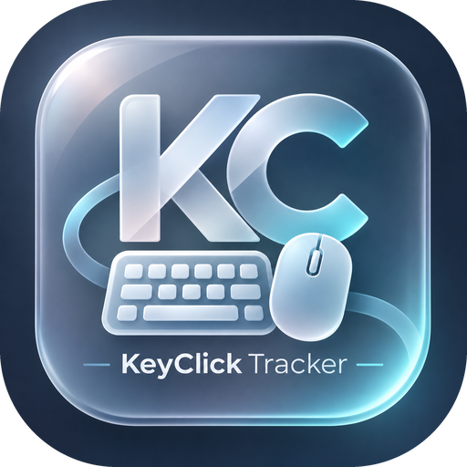

# KeyClick Tracker

<p align="center"></p>

_A quiet, private Windows app that counts your key presses, mouse clicks and scrolls, so you can see the shape of your day._

**It only stores counts.** It never records what you type, where your cursor goes, or any text. Everything stays on your computer in `%LOCALAPPDATA%\KeyScope\activity.json`, and nothing is sent anywhere.

## Latest release: 2.6.0

**[Download KeyClick Tracker 2.6.0](https://github.com/kosandra0/KeyClick-Tracker/releases/tag/v2.6.0)**

- **New: scroll rate.** The Speed page has a "Scroll rate now" card, and the floating live box shows a third figure beside WPM and CPM. Both count scroll events over the last few seconds.
- **New: scroll unit in Settings.** Settings > Measuring units > Scroll rate chooses SPS (scrolls per second), SPM (per minute) or SPH (per hour). It applies to the app and the floating live box.
- **Fixed: the floating live box can no longer be dragged flat.** It used to be possible to make it 56 pixels high, which cut off its numbers. The smallest size is now 170 × 72 pixels, and a box saved that flat is reset to a usable size on startup. The resize handle stays visible.
- **Changed:** the detailed live box starts 330 pixels wide to fit the third figure.
- Your data is untouched. Checksums are in `SHA256SUMS.txt` and in the release notes.

Earlier releases: [2.5.0](https://github.com/kosandra0/KeyClick-Tracker/releases/tag/v2.5.0) (always opens as a real app, installs the WebView2 Runtime when missing), [2.4.0](https://github.com/kosandra0/KeyClick-Tracker/releases/tag/v2.4.0) (hold times, scroll sessions, Applications page), [2.3.0](https://github.com/kosandra0/KeyClick-Tracker/releases/tag/v2.3.0) (Windows and Alt shortcuts counted), [2.2.0](https://github.com/kosandra0/KeyClick-Tracker/releases/tag/v2.2.0) (Lite mode, logo everywhere), [2.1.0](https://github.com/kosandra0/KeyClick-Tracker/releases/tag/v2.1.0) (choose your app logo), [2.0.0](https://github.com/kosandra0/KeyClick-Tracker/releases/tag/v2.0.0) (tray menu, reminders, summaries, practice), [1.2.3](https://github.com/kosandra0/KeyClick-Tracker/releases/tag/v1.2.3) (live box stays on screen), [1.2.2](https://github.com/kosandra0/KeyClick-Tracker/releases/tag/v1.2.2) (administrator counting, sign-in start, setup program) and [1.2.0](https://github.com/kosandra0/KeyClick-Tracker/releases/tag/v1.2.0) (Analytics and live box themes).

## Download and install

Two files are published with each release:

| File | Use it when |
|---|---|
| `KeyClick-Tracker-Setup-vX.Y.Z.exe` | You want a normal install: Program Files, Start Menu shortcut, an entry in Apps and features, and start at sign-in. |
| `KeyClick-Tracker-vX.Y.Z.exe` | You want to run it without installing. |

Both run with **administrator rights**. This is required so that keys, clicks and scrolls are counted in administrator windows, such as an elevated PowerShell. Windows asks for permission when you open the app by hand. At sign-in it starts without a prompt.

Requirements: Windows 10 or 11, 64-bit. The app draws its window with the Microsoft Edge WebView2 Runtime, which is already on Windows 11 and most Windows 10 PCs. If it is missing, the setup program (or the app, when started without it) downloads and installs it from Microsoft, which needs an internet connection once.

**"Windows protected your PC" (SmartScreen).** The programs are not yet signed with a paid code-signing certificate, so on first run Windows may show a blue notice saying the publisher is unknown. This is Windows being careful about a new, unsigned program. Compare the SHA-256 checksum below with the one on the release page; if it matches, click **More info**, then **Run anyway**. The source code is in this repository.

**Check the download.** In PowerShell:

```powershell
Get-FileHash .\KeyClick-Tracker-Setup-v2.6.0.exe -Algorithm SHA256
```

Compare the result with the checksum listed on the release page.

## How to use it

1. **Open the app.** It shows the Overview page with live numbers for keys, clicks and scrolls.
2. **Read the pages in the sidebar:**
   - **Overview:** today's totals, live speed, goals, streaks, and the Little observations list.
   - **Keyboard and Mouse:** where your keys and clicks land, with heat maps.
   - **Speed:** typing and clicking speed, in WPM, WPS, WPH, CPM, CPS and CPH, live and per period.
   - **Analytics:** charts and insights built from your counts (see below).
   - **History:** day-by-day totals, a day panel with what was held on the day you pick, held time per period, and the newest 2,000 individual holds and scroll sessions.
   - **Applications:** which programs received your keys, clicks and scrolls, with their own keyboard, mouse buttons and scrolling.
   - **Settings:** appearance, the live box, the tray behaviour, goals and data.
3. **Close the window.** By default it goes to the system tray and keeps counting. Right-click the tray icon to open the app, pause or resume counting, or exit. To make closing quit the app instead, turn off **Keep running in the tray when closed** in Settings.
4. **Keep the live box.** Turn on the floating live box in Settings. It stays on top of other windows and shows your current speed and totals. Drag it to move it and drag its bottom-right corner to resize it. Its ✕ turns the setting off. Choose one of ten themes in Appearance.
5. **Export or import your data.** Use Settings to export to JSON, TXT or Markdown, or to import a file. Only these three file types are accepted. A backup of your data is made automatically before each update.

## Features

- **Live counting:** key presses, mouse clicks and scrolls, with sliding digits.
- **Hold times:** how long every key and mouse button is held, measured from press to release, shown live and per key, button, program, day and period. Totals add up every hold, so they can be longer than the time that passed.
- **Scroll sessions:** wheel events less than 0.4 seconds apart form a session; its time is an estimate from the gaps between wheel events and is labelled that way.
- **Applications:** the programs that received your input, with icons, counts, hold times and a per-program keyboard heat map and mouse buttons.
- **Keys and buttons that glow** while held or pressed.
- **Speed:** typing speed (WPS, WPM, WPH), clicking speed (CPS, CPM, CPH) and scroll rate (SPS, SPM, SPH), live and per period. Choose the units in Settings > Measuring units.
- **Overview, Keyboard, Mouse, Speed and History pages:** heat maps, goals, streaks and milestones.
- **Analytics:** activity bars from hourly to yearly, a trend line with a moving average, an hourly rhythm and 24-hour clock, a weekly rhythm, an hour-by-weekday heat map, a year-of-days calendar, an activity mix, and a breakdown of how you type.
- **Insight engine:** plain-language findings about your habits, such as your pace today against a normal day, your sharpest three hours, consistency, week-on-week momentum and unusual days. It shows a dash until it has enough history to be sure.
- **Four scores:** activity score, consistency, momentum and a projected total for today.
- **Floating live box:** always on top, resizable (not below 170 × 72 pixels), draggable, showing WPM, CPM and scroll rate, with ten themes and its own position memory. It is repaired automatically if it ends up off-screen.
- **Activity glow:** the stat boxes light up when they change (keys in blue, clicks in lilac, scrolls in green).
- **Appearance:** app themes, ten official typefaces (Times New Roman, Arial, Calibri, Cambria, Georgia, Book Antiqua, Palatino Linotype, Verdana, Tahoma, Comic Sans MS), and other font families.
- **Break reminder:** after a long stretch of continuous activity, a gentle tray notification suggests a short break.
- **Typing test:** a short test with a personal best kept on this PC.
- **Single copy:** opening the app a second time does nothing, so counts are never doubled.

## Your data

| What | Where | Notes |
|---|---|---|
| Counts and settings | `%LOCALAPPDATA%\KeyScope\activity.json` | The only data file. It holds counts per day and per hour, hold times, scroll sessions, per-program counts, the newest 2,000 hold records, and your settings. |
| Automatic backups | `%LOCALAPPDATA%\KeyScope\Backups` | Made before each update. Never overwritten. |
| Browser-engine data | `%LOCALAPPDATA%\KeyScope\WebViewProfile` | Preferences and the typing-test best. Caches are rebuilt automatically. |

The data folder keeps its earlier name so that existing data stays readable. Updating or uninstalling the app keeps your data. Remove the folder yourself if you want it gone.

## Privacy

- Counts and times only. The app stores how often and how long each key (by name, such as A or Space), mouse button and program (by file name) was used. It never stores typed text, the order of your keys, cursor positions, window titles, clipboard contents or screenshots.
- Nothing is sent over the internet. The app serves its own page on `127.0.0.1` for the window only.

## Start with Windows

The setup program adds a Task Scheduler sign-in task that runs the app with administrator rights, so it starts without a prompt. The task is repaired each time the app opens. You can turn it off in Task Scheduler (task name `KeyClick Tracker`).

## Uninstall

Use **Apps and features** (or run the setup with `/UNINSTALL`). Your data folder is kept.

## Build from source

The source is in `Native-Windows-Source`. It needs Go 1.27 and the MinGW `windres` tool on the PATH, or the portable Go in `_tools`.

```powershell
cd Native-Windows-Source
powershell -ExecutionPolicy Bypass -File .\build.ps1
```

The build writes `installers\Setup\KeyClick-Tracker-Setup-vX.Y.Z.exe` and `installers\Standalone\KeyClick-Tracker-vX.Y.Z.exe`, with the version taken from `store.go`. Add `-Install` to update an installed copy silently.

## Version history

| Version | Date | Highlights |
|---|---|---|
| 2.6.0 | 2026-11-24 | Scroll rate (SPS, SPM, SPH) on the Speed page and in the floating live box, with a unit setting; the floating live box can no longer be dragged flat. |
| 2.5.0 | 2026-11-22 | Always opens as a real app (no browser, no blank window); installs the WebView2 Runtime when missing; file version information. |
| 2.4.0 | 2026-11-19 | Hold times for keys and buttons, scroll sessions, Applications page, live numbers, History additions, complete export and import. |
| 2.3.0 | 2026-11-19 | Windows and Alt shortcut keys counted, scrolls per program, tidier About page. |
| 2.2.0 | 2026-11-18 | Lite mode for older computers, your logo in Task Manager and the Start menu. |
| 2.1.0 | 2026-11-18 | Choose your app logo. |
| 2.0.0 | 2026-11-17 | Tray menu, reminders, summaries, practice, per-program counts, backup restore. |
| 1.2.3 | 2026-11-15 | The floating live box stays on screen after the window is closed to the tray. |
| 1.2.2 | 2026-11-15 | Counts administrator windows, starts at sign-in, setup program. |
| 1.2.1 | 2026-11-15 | Counting in every app (Raw Input) and a steady Little observations list. |
| 1.2.0 | 2026-11-15 | Analytics page, insight engine, live box themes, official typefaces. |
| 1.1.0 | 2026-11-14 | Earlier release. |

The full update log is inside the app, under About.

## Licence and contact

Made by kosandra0. Contact: [Instagram](https://www.instagram.com/i.have.lost.it.all/) · [Telegram](https://t.me/i_am_the_last_passenger) · Discord: `3.11.17`.
